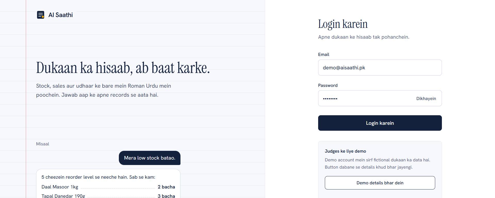
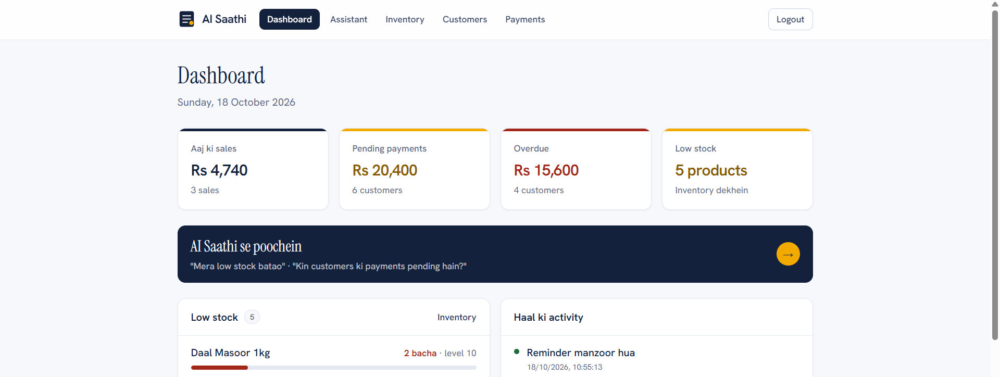
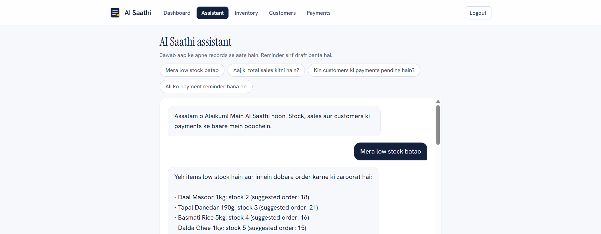
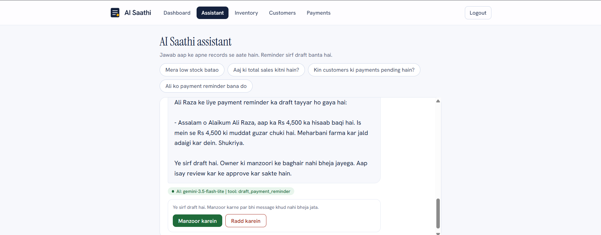
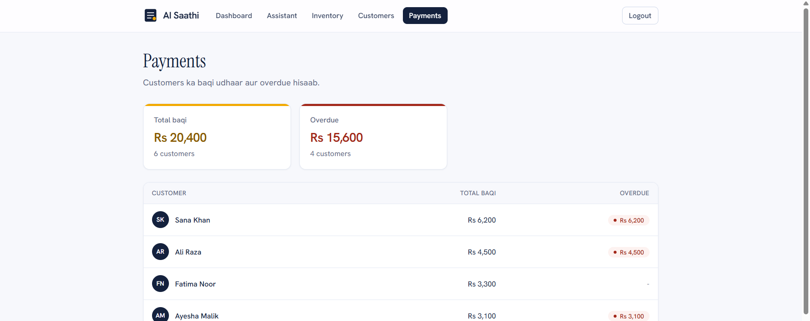

# AI Saathi

An AI-powered business assistant for small shop owners in Pakistan. Ask in Roman Urdu or English about stock, sales and pending customer payments, and get payment-reminder drafts that the owner reviews and approves.

- **Live demo:** https://ai-saathi-coral.vercel.app
- **Demo video:** https://youtu.be/g3nKxCWuXis
- **Demo login:** `demo@aisaathi.pk` / `demo1234` (fictional demo shop data)
- **Hackathon:** NYLP AI Hackathon 2026, focus area: AI Agents
- **Team:** codesminds

## Problem

Many small shops in Pakistan still run on notebooks and spreadsheets. Owners struggle to see which products are running low, who still owes them money, and how sales are doing. Chasing late payments is easy to forget, and ordinary business software feels complicated for non-technical users.

## Solution

AI Saathi connects an AI agent to the shop's own records. The owner types a question in everyday language, for example:

- "Mera low stock batao"
- "Aaj ki total sales kitni hain?"
- "Kin customers ki payments pending hain?"
- "Ali ko payment reminder bana do"

The agent picks an approved backend tool, the backend reads the real data, and the AI explains the result in simple language. Actions such as payment reminders are only prepared as drafts. The owner must approve them.

## How the AI agent works

1. The owner asks a question in the chat.
2. The Gemini model interprets the request.
3. The model chooses one of the approved backend tools (function calling).
4. The server runs the tool, validates input and reads or calculates the data.
5. The model explains the tool result in the owner's language.
6. If an action is needed (a reminder), a **draft** is created and the owner approves or rejects it.

The model never queries the database directly. All numbers come from trusted backend code.

### Tools exposed to the agent

| Tool | Purpose |
|---|---|
| `get_inventory_summary` | Product count, low-stock count, stock value |
| `get_low_stock` | Products below reorder level with suggested reorder quantity |
| `search_products` | Find products by name with stock and price |
| `get_sales_summary` | Sales total and transaction count for today, 7 days or 30 days |
| `list_pending_accounts` | Customers with unpaid balances |
| `list_overdue_accounts` | Customers whose due date has passed |
| `get_customer_balance` | Outstanding balance for one customer |
| `draft_payment_reminder` | Creates a DRAFT reminder (never sent automatically) |

## AI methodology and model/API usage

- **Third-party AI API used:** Google Gemini API (`@google/genai`) with function calling.
- **Models:** `gemini-3.5-flash-lite` (primary), then `gemini-3.1-flash-lite` and `gemini-3.8-flash` if a model's free-tier quota runs out. Models are configurable with the `GEMINI_MODELS` environment variable.
- **Prompting:** a system prompt (`src/agent/prompts.ts`) tells the model to reply in the owner's language, always call a tool for business data, never invent numbers, write amounts as "Rs 4,500", and never claim to send messages. The last few chat turns are sent so the owner can answer follow-up questions (for example, choosing between two customers named Ali).
- **Tool loop:** up to 5 model-tool steps per question (`src/agent/runAgent.ts`).
- **Fallback:** if every Gemini model is unavailable or over quota, a simple keyword assistant (`src/agent/fallback.ts`) answers the main questions using the same tools. The chat shows which mode answered (`AI: <model name>` or `mode: keyword`).
- **Free tier note:** Gemini free-tier requests may be used by Google to improve its products. This project only uses fictional demo data.

## Features

- Login with protected pages and API routes
- Dashboard with clickable cards: today's sales, pending and overdue payments, low-stock alerts and recent activity
- Inventory page with reorder status
- Customers and payments pages with balances and overdue amounts
- AI assistant chat (Roman Urdu / English)
- Reminder drafts with Approve / Reject buttons
- Audit log of drafted, approved and rejected reminders

## Responsible AI and security

- Inputs are validated on the server (zod).
- The model can only call the tools listed above. It cannot run arbitrary queries.
- Financial totals are computed by backend services, not by the model.
- Reminders are created as `DRAFT`. Only the owner can approve or reject, and each decision is written to the audit log. A reminder can only be decided once.
- API keys and database credentials live in environment variables. No secrets are committed.

## Tech stack

Next.js, TypeScript, Prisma, PostgreSQL, Google Gemini API, Zod, deployed on Vercel.

## Setup

Requires Node.js 20.9 or newer and a PostgreSQL database.

```bash
git clone https://github.com/CoDEMINDS02/ai-saathi.git
cd ai-saathi
npm install
```

Create `.env.local` (see `.env.example` for the variable names) and set at least:

```
DATABASE_URL=your_postgres_connection_string
AUTH_SECRET=any_long_random_string
GEMINI_API_KEY=your_google_ai_studio_key
```

Then set up the database and run the app:

```bash
npx prisma generate
npx prisma migrate deploy
npx prisma db seed
npm run dev
```

Open http://localhost:3000/login and sign in with the demo account above.

## Screenshots

| | |
|---|---|
|  |  |
|  |  |
|  | |

## Team

| Member | Role | Contribution |
|---|---|---|
| Umair | Frontend developer | Built the user interface: login, dashboard, AI assistant chat, inventory, customers and payments pages, and navigation. |
| Anosha | Backend developer | Built the backend: database and seed data, services and API routes, authentication and the AI agent tools. |

AI coding assistants used: Claude Sonnet 5.5 (Anthropic). The team reviewed and tested everything that was submitted.

## Known limitations

- Approving a reminder does not send it. There is no WhatsApp or SMS integration yet. The owner copies the approved message and sends it manually.
- The demo uses fictional data for one shop and one owner account.
- The free Gemini tier has daily request limits. When they are used up, the app falls back to a simpler keyword assistant with fixed phrases.
- Roman Urdu understanding depends on the model and can be imperfect.
- Future work: WhatsApp sending after approval, stock updates by chat, multi-shop accounts, reports.

## Acknowledgements

Next.js, Prisma, Zod and the Google Gemini API.


